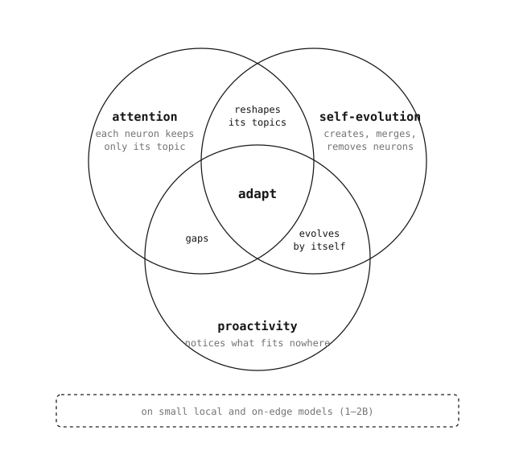

# adapt

adapt is a TypeScript memory layer designed around attention, self-evolution and proactivity, optimized for small local and on-edge models (1–2B).

adapt takes a different approach to memory. Most memory layers are recall-based: they store data and retrieve it when asked. adapt is attention-based: it tracks what you tell it to, and decides which incoming data deserves its effort. This lets adapt keep a small, current memory instead of a growing archive, notice data that fits nothing it tracks, and reshape what it tracks as the data changes. Each of these steps is narrow enough for a small local model.



A brain holds a set of neurons. Each neuron has a topic and one plain-text memory. `inject()` sends text to every neuron; each extracts what fits its topic and rewrites its memory. Text no neuron keeps is recorded as a gap. Gaps trigger evolution, which creates, merges or removes neurons. `ask()` routes a question to the neurons whose topics match and merges their answers.

## Install

```bash
npm i adapt-memory   # not on npm yet; npm currently serves 0.0.6
```

## Quickstart

Load `lfm3-1.7b` in LM Studio with a 32768-token context and start its server on port 1234. Then:

```ts
import { Brain } from 'adapt-memory'
import { SQLiteBrainStore } from 'adapt-memory/sqlite' // npm i better-sqlite3

const brain = await Brain.create({
  prompt: 'Track my coding preferences and food habits.',
  store: new SQLiteBrainStore('./brain.db'),
})
await brain.inject(['I always use strict TypeScript.', 'Dinner: vegetarian ramen.'])
const answer = await brain.ask('What do I prefer in code?')
console.log(answer.insight, answer.gaps)
await brain.dispose()
// later: const brain = await Brain.restore('./brain.db')
```

`inject` means learn from this data; `ask` means ask what the brain understands, and returns an answer, its sources and what the model could not answer. No model is named, so adapt uses LFM3 1.7B on LM Studio. `localModel('<id>', { baseURL })` points it at another local model or server, untested so far. The code needs ESM and top-level `await`.

## Status

MIT. This release is not on npm yet ([changelog](CHANGELOG.md)); until it is, `npm i adapt-memory` installs 0.0.6, which has a different API. Tested on Node and Bun; a CommonJS build is provided for Electron, untested. Memory in RAM or SQLite.

- **Shipped:** neurons and brains; learning from text; `ask` in `direct` and `deep` modes; gaps; [evolution](https://adapt.unbody.io/docs/concepts#self-evolving) on by default; [background neurons](https://adapt.unbody.io/docs/how-it-works#6-background-neurons); local models by default; save and restore.
- **Next:** attention to change, bursts and drift ([#25](https://github.com/unbody-io/adapt/issues/25)); expectation, including "what would I reply to Alex?" ([#26](https://github.com/unbody-io/adapt/issues/26)); explicit history: dated snapshots of each understanding, and a store of the user's own messages.
- **Where this is going:** adapt will learn what to expect from your data and notice when reality differs. Today: attention-based understanding that organizes itself. Next: attention to change, and prediction.

Limits: a neuron keeps no past versions of its understanding, so an old value is lost when a rewrite keeps only the new one. Inputs are 2000 characters at most. [`continuous` governance](https://adapt.unbody.io/docs/guides#memory-size-governance) stops learning once the understanding is full. Evolution needs tool calling. For verbatim recall, citations and audit trails, use RAG or a database alongside adapt.

**Upgrading from 0.0.6:** 0.1.0 does not support 0.0.6 stores. Start with a new one. See the changelog.

## Links

- Docs: <https://adapt.unbody.io/docs>
- [Changelog](https://github.com/unbody-io/adapt/blob/main/CHANGELOG.md) · [npm](https://www.npmjs.com/package/adapt-memory)
- Everything in one file, for coding agents: <https://adapt.unbody.io/llms-full.txt>
